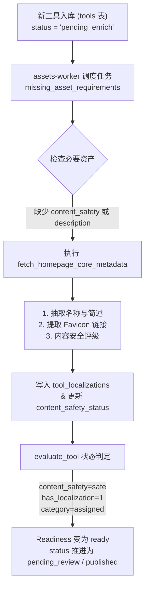
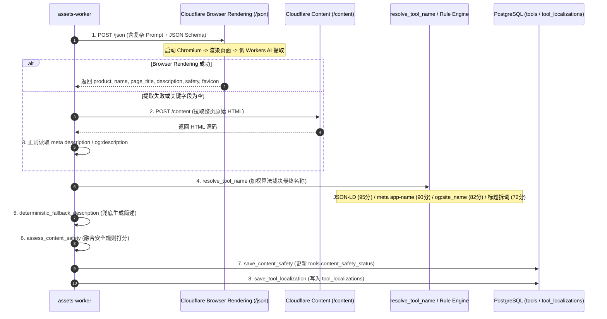

# 首页轻量元数据提取与本地化文本生成（名称、简述）逻辑分析报告

> **报告版本**: 2026-10-28.1  
> **涉及服务**: `tool-data-runner` (`assets-worker`) & `discovery-runner`  
> **核心代码位置**: 
> - [runner.py:2511 (`fetch_homepage_core_metadata`)](../../runner.py#L2511-L2641)
> - [runner.py:1621 (`resolve_tool_name`)](../../runner.py#L1621-L1710)
> - [runner.py:2174 (`fetch_structured_asset_data`)](../../runner.py#L2174-L2260)
> - [runner.py:6178 (`save_tool_localization`)](../../runner.py#L6178-L6285)
> - [runner.py:5655 (`evaluate_tool`)](../../runner.py#L5655-L5835)

---

## 一、 为什么会有这个步骤？（触发场景与依赖关系）

在整个产品生命周期中，一个工具（Tool）从被发现到能够正式发布展示，必须经过状态就绪评估（`evaluate_tool`）。



### 1. 核心触发条件
在 `tool-data-runner/runner.py#L6369` 的 `missing_asset_requirements` 中：
- `ASSET_REQUIREMENT_ORDER = ("content_safety", "favicon", "description")`
- 如果数据库中该工具在 `tools` 表的 `content_safety_status != 'safe'`，或者在 `tool_localizations` 表中缺少有效的 `name` 或 `short_description`，任务调度器就会认为该工具**缺少核心本地化数据与安全标记**。

### 2. 阻塞门禁（Blocking Gate）
在 `tool-data-runner/runner.py#L5776` 的 `evaluate_tool` 中，决定工具能否就绪（`ready`）的 `blocking` 项如下：
1. `content_safety`: 内容安全状态必须为 `safe`；
2. `published_localization`: 必须存在至少一条本地化文本（`name` 非空且 `short_description` 非空）；
3. `name_quality`: 名称长度 $\le 80$ 字符、未包含 HTML 标签或语法残留、状态非 `rejected`/`needs_review`；
4. `category`: 已分配主类目；
5. `source_evidence`: 具备溯源记录。

> **结论**：“名称与简述”不仅用于前端展示，还是阻断工具发布的**硬性卡点**。

---

## 二、 现有处理逻辑全景拆解

当前执行入口为 `fetch_homepage_core_metadata(task)`，其内部实际承载了**5个跨度极大的子目标**：



### 环节 1：远程无头浏览器结构化抽取（`fetch_structured_asset_data`）
- **实现方式**: 调用 Cloudflare Browser Rendering Quick Action 接口 `POST /browser-rendering/json`。
- **Payload 内容**:
  - 传入目标 URL 与强格式化的 JSON Schema（包含 11 个必须字段）。
  - 传入长 Prompt：要求提取产品官方专有名称（排除 Tagline、防止“Just a moment”等防爬文本干扰）、页面 Title、客观事实简述、Favicon 链接，并分类该产品是否属于色情/脱衣/成人等 NSFW 风险。
- **底层行为**: Cloudflare 在云端打开无头 Chromium，执行页面 JS 渲染，然后调用 LLM（Workers AI 模型如 `llama-3.1-8b-instruct`）分析渲染后的 DOM 树生成 JSON。

### 环节 2：HTML 兜底抓取（`fetch_homepage_content`）
- **触发条件**: 如果上述 `/json` 抛错、超时，或者提取结果中缺少 `product_name` 或 `description`。
- **行为**: 再次调用 Cloudflare Browser Rendering `/content`（或静态 HTTP），把完整 HTML 页面下载下来，然后用正则提取：
  - `<meta name="description" content="...">`
  - `<meta property="og:description" content="...">`
  - `<meta name="twitter:description" content="...">`

### 环节 3：名称裁决与清洗算法（`resolve_tool_name`）
代码设计了一套十分繁琐的“多来源竞选与加权打分”模型：
| 候选来源 | 基础权重 | 计分微调规则 |
|---|:---:|---|
| **JSON-LD Schema.org** (`Product`/`SoftwareApplication`/`WebSite.name`) | **95** | 命中域名品牌 +15 分 |
| **Meta 标签** (`application-name` / `apple-mobile-web-app-title`) | **90** | 长度 > 50 字符 -15 分 |
| **OpenGraph** (`og:site_name`) | **82** | 单词数 > 8 词 -10 分 |
| **模型提取** (`model_product_name`) | **70~90** | 必须在 HTML 原文中可搜到，否则作废 |
| **Title 拆分** (`<title>` 依 `-`, `\|`, `–`, `:` 切割的词段) | **72** | 来源单薄且不符合域名，截断封顶 84 分 |
| **域名推导兜底** (`domain_fallback`) | **45** | 仅在前述全部缺失时使用，需人工审核 |

- **冲突检测**: 若多个来源的名字规整后不一致，强制将最高分压制在 84 分以下，并打上 `needs_review` 标记。
- **自动放行**: 只有分数 $\ge 60$ 且无冲突时，标记为 `auto_approved`。

### 环节 4：简述缺失兜底（`deterministic_fallback_description`）
- 如果经过模型和 Meta 提取后描述仍为空：
  - 尝试抓取正文中的第一个 `<h1>` 标签；
  - 尝试抓取正文第一个有效 `<p>` 段落；
  - 最终兜底：生成模板文本 `"{Product Name} is an AI product available at {domain}."`。

### 环节 5：内容安全判定（`assess_content_safety`）
- 将模型输出的 `content_safety_label`、域名的黄暴黑名单正则（如 `porn|nsfw|deepnude|undress`）以及 HTML 文本中的敏感词进行融合，打出 `safe`、`nsfw` 或 `uncertain`。

### 环节 6：落库保存（`save_tool_localization`）
- 写入 `tool_localizations` 表：
  - 生成公共 Slug（`numbered_public_slug`）；
  - 写入 `name`, `tagline`, `short_description`, `name_source`, `name_confidence`, `name_review_status` 等；
  - 记录审计证据 `name_evidence`（含清洗规则版本、来源 URL、匹配快照）。

---

## 三、 核心痛点与性能瓶颈诊断

```
当前单次执行代价:
[Cloudflare 无头浏览器启动] (2~6秒)
       +
[DOM 渲染与反爬等待] (1~4秒)
       +
[Workers AI 大模型提取推理] (2~5秒)
       = 单工具元数据抽取总耗时高达 5 ~ 15 秒！
```

### 1. 严重与上游 `discovery-runner` / 定向爬虫重叠（重复抓取、重复推断）
- **现象**: 
  - 当一个新工具被 `discovery-runner`（或定向爬虫）抓取并经由 Decider 评估合格时，**上游此时已经拿到了该产品的名称（`submitted_name`）、导航站提供的精准简述（`description_hint`）以及首页预检元数据（`Title / Description`）**。
  - 但是，`discovery-runner/src/candidates.ts` 往 `tools` 表写记录时，**只插入了 `canonical_slug`, `official_url`, `normalized_domain`**，把 `tool_localizations` 留白。
- **代价**: 工具入库后，下游 `tool-data-runner` 又傻傻地重新拉起一个无头浏览器，重新调大模型去抓一遍一模一样的东西！

### 2. Cloudflare Browser Rendering `/json` 成本极高且脆弱
- **高失败率与超时**: 每次调用无头 Chromium 打开第三方未知的外部站点，极易遭遇 Cloudflare 6000 错误（Target page crashed / Navigation timeout）、Cloudflare 5秒盾拦截、或 API 429 并发超限。
- **过度计算**: 实际上 95% 以上的标准 AI 产品，其首页源码头部 `<head>` 已经明确写了 `<title>`、`<meta name="description">`、`<meta property="og:site_name">`。用无头浏览器 + 8B LLM 去读这几行静态 HTML 属于“杀鸡用牛刀”。

### 3. `resolve_tool_name` 规则过度设计
- 当前仲裁算法包含了 6 级来源、正负分修正、多源交叉防重、编辑距离检查，逻辑跨度数百行。
- 但在实际生产中，绝大多数工具的官方名称直接由 `og:site_name` 或页面 `<title>` 的第一个分隔段即可 100% 准确获取，过度复杂的模型提取反倒经常提取出营销标语（如 "Home - The Next Gen AI Platform"）。

### 4. 职责耦合严重
- `fetch_homepage_core_metadata` 将“名称提取”、“简述提取”、“网页存活探测”、“Favicon 链接解析”、“NSFW 内容安全打分”全部打包在一个 API 调用中。一旦其中一项失败（如 LLM 返回 JSON 不合规），整条任务全部重试。

---

## 四、 具体可删减与精简方案评估

针对上述问题，建议按以下方案进行大幅删减与性能优化：

| 方案 | 改造核心 | 预计提速 / 节省 | 风险与改动量 | 推荐度 |
|---|---|---|---|---|
| **方案 1：上游直通（入库即就绪）** | 在 `discovery-runner` 和爬虫入库时直接写入 `tool_localizations` | **耗时从 15s 降至 0s**<br/>(100% 跳过下游抓取) | 极低（仅需补全 INSERT 语句） | ⭐⭐⭐⭐⭐ **(强烈推荐)** |
| **方案 2：轻量静态 HTTP 优先** | 优先用纯 HTTP GET 读取 `<head>` (64KB)，仅失败时走浏览器 | **节约 90% 以上无头浏览器调用**，耗时由 10s 降至 200ms | 低（新增轻量 static fetcher） | ⭐⭐⭐⭐⭐ **(强烈推荐)** |
| **方案 3：精简名称仲裁算法** | 砍除模型名称提取 (`model_product_name`) 与复杂打分，改用固定优先序 | 削减 ~150 行冗余规则代码，消除模型幻觉 | 极低 | ⭐⭐⭐⭐ |
| **方案 4：解耦与降级内容安全** | 既然 Decider 已做准入，默认标记 `safe`，仅保留本地正则兜底 | 剥离无头浏览器中的 NSFW Prompt | 极低 | ⭐⭐⭐⭐ |

---

### 详细实施建议

#### 方案 1（极力推荐）：上游直通，下游零开销
在 `discovery-runner/src/candidates.ts` 批准候选写入 `tools` 时，同步执行：
```sql
-- 1. 写入工具基础表
INSERT INTO tools (canonical_slug, official_url, normalized_domain, primary_source_type, content_safety_status, status)
VALUES (?, ?, ?, ?, 'safe', 'pending_enrich');

-- 2. 直接将 discovery 阶段已经拿到的高质量名称与描述写入本地化表
INSERT INTO tool_localizations (
  tool_id, locale_code, localized_slug, name, short_description,
  name_source, name_confidence, name_review_status
)
VALUES (
  new_tool_id, 'en', slug, 
  coalesce(candidate.submitted_name, clean_title),
  coalesce(candidate.description_hint, meta_description),
  'discovery_preflight', 90, 'auto_approved'
);
```
> **收益**: 下游 `tool-data-runner` 的 `missing_asset_requirements` 检查时直接发现 `has_localization = 1` 且 `has_content_safety = 1`，**完全不需要再调用无头浏览器**，工具秒级直接推进至 `ready`！

#### 方案 2：将 `fetch_homepage_core_metadata` 改为轻量级 HTTP 优先
在下游确实需要抓取元数据时（例如无元数据的手动导入工具）：
1. **第 1 步**: 发起常规异步 HTTP GET（`httpx.AsyncClient`，流式拉取前 64KB 内容，超时 3 秒）。
2. **第 2 步**: 本地正则直接解析：
   ```python
   # 3 行正则即可完成 95% 的元数据解析
   title = re.search(r"<title[^>]*>(.*?)</title>", head_html, re.I)
   desc = re.search(r'<meta[^>]+(?:name|property)=["\'](?:og:description|description)["\'][^>]+content=["\'](.*?)["\']', head_html, re.I)
   site_name = re.search(r'<meta[^>]+property=["\']og:site_name["\'][^>]+content=["\'](.*?)["\']', head_html, re.I)
   ```
3. **第 3 步**: 仅当 HTTP 状态码为 403 / 503（遭遇 Cloudflare 反爬盾）或完全解析不出标题描述时，才走昂贵的 `Cloudflare Browser Rendering`。

---

## 五、 总结与决策建议

1. **核心冗余点**: 
   - 现有的“抓取首页轻量元数据生成本地化文本”最大的问题是**没有复用发现阶段（Decider / 爬虫）已有的现成数据**，导致了下游重复且昂贵的无头浏览器渲染与大模型推理。
2. **立竿见影的改动**:
   - **立即采纳方案 1**: 在 `discovery-runner` 写入 `tools` 时顺带写入 `tool_localizations` 和 `content_safety_status = 'safe'`。这样，未来所有新入库的 AI 工具**无需耗费数秒等待浏览器渲染**，直接立即可用！
   - **采纳方案 2**: 将 `runner.py` 中的 `fetch_homepage_core_metadata` 降级为以静态 HTTP GET 为主，彻底解放 Cloudflare Browser Rendering 额度。
