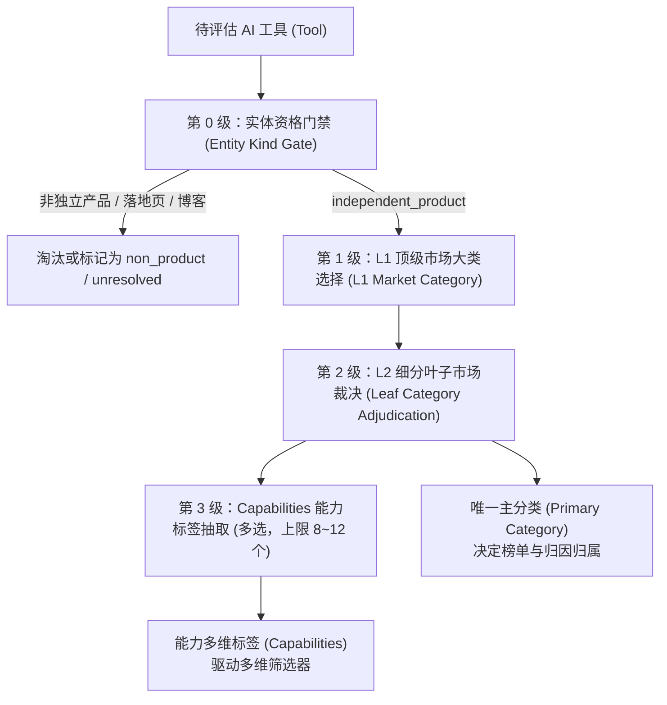
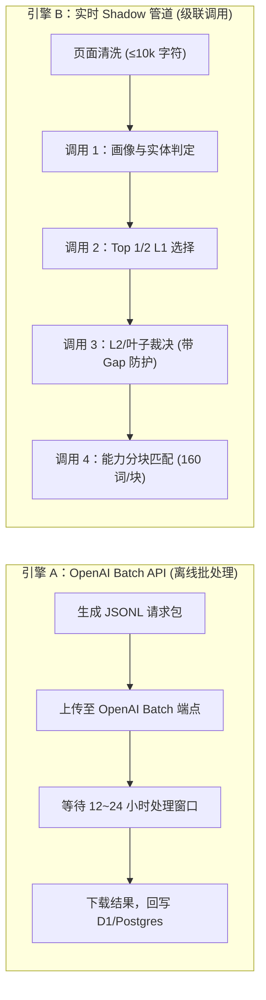

# AI 工具分类与品类体系（Taxonomy System）现状梳理与第三方评估报告

> **报告版本**：v1.0  
> **报告对象**：第三方架构师 / 评审团队 / 业务决策层  
> **数据基准**：2026-10-28 生产数据库只读核验与 `tool-data-runner` 源码基线  
> **系统定位**：面向 AI SaaS 创始人与增长团队的竞争情报与增长归因平台（包含品类领跑榜 Category Leaderboards、动量异动榜 Category Movers、品类大盘流量归因与多维 Screener）

---

## 一、 业务背景：为什么分类必须“极其严格”？

在一般 AI 导航站中，分类仅充当粗略的浏览目录（Directory Tag）；但在本平台（Sigpik）中，**分类是驱动高净值商业化功能的核心骨架**。

平台提供以下核心特性：
1. **品类领跑榜（Category Leaderboards & Movers）**：例如在 `Video & Animation` 或 `Marketing & SEO` 品类中，横向追踪谁是当月流量突破者（Breakout）、谁的域名评级（DR）增幅最高。如果一个“AI 广告文案生成器”被误分入“视频动画”，整个榜单的分析结论和行业基准将彻底失真。
2. **同业增长归因与竞品对标（Competitive Attribution）**：用户在详情页对比“同品类相近梯队竞品（Nearby Competitors）”的流量与关键词分布。品类判定一旦漂移，竞品集合即失去参考意义。
3. **专业筛选器（Ranking Screener & Developer API）**：面向付费客户与 API 订阅者，提供基于二级叶子品类（Leaf Category）的精确过滤。
4. **实体纯度（Entity Kind Gate）**：严格排除非独立产品（如单篇技术博客、母系统内部插件、SEO 落地页、停服镜像），确保进入榜单与筛选器的必须是**具备独立品牌、可定价、可比较的独立 SaaS 实体**。

**核心挑战**：分类越严格、判定链条越长，进入流通的门槛就越高。如何在“杜绝错误分类破坏榜单信噪比”与“保障新发现 SaaS 及时入库监控”之间取得最佳平衡，是本次评估的核心课题。

---

## 二、 分类体系全景架构（Taxonomy Architecture）

当前系统采用**多维分类体系 v2（Multidimensional Taxonomy v2）**，将工具分为独立维度：



### 1. 维度与词表规模（生产当前有效激活）
- **L1 顶级市场大类（Primary Root）**：固定 20 个大类（如 `chat-agents`、`video-animation`、`coding-development`、`marketing-seo`、`finance-legal` 等）。
- **L2 叶子节点（Primary Leaf Category）**：全库目前共 **155 个激活的 primary category terms**。每个产品**有且仅有一个**有效主分类。
- **能力维度（Capabilities）**：全库共 **791 个激活的 capability terms**。产品可命中 0~12 个能力，每个能力必须绑定官网正文证据。
- **辅助维度**：24 个使用场景（`use_case`）与 17 个目标人群（`user_type`）。

### 2. 实体类型判断（Entity Kind）
系统在分类前严格执行实体分类，支持 8 种类型：
- `independent_product`：可独立注册、定价、比较的商业产品（唯一放行者）。
- `app_or_extension`：桌面/浏览器插件（需视目录策略放行）。
- `product_module` / `feature_landing`：仅母产品的一个功能或 SEO 页面（拦截）。
- `company_site`：多业务控股公司官网，非具体产品（拦截）。
- `non_product`：博客、资讯、文档、论坛（永久拦截）。
- `unresolved`：证据不足，转入复核或等待重新抓取。

---

## 三、 双引擎实现：OpenAI Batch 与实时 Shadow

系统实现并维护了两套分类执行引擎，通过 `docker-compose.dokploy.yml` 进行环境切换：



### 模式 A：OpenAI Batch API 批处理（生产当前默认）
- **代码实现**：`taxonomy_batch.py`
- **模型配置**：主模型 `gpt-5.6-luna`，升级裁决模型 `gpt-5.6-terra`。
- **机制**：汇集待处理工具列表，提交 OpenAI `/v1/responses` 异步任务。
- **致命瓶颈**：**处理周期长（12~24 小时）**。在新工具快速发现阶段，新入库工具必须在队列中滞留漫长的批处理周期。

### 模式 B：实时 Shadow 管道（浏览器抓取 + 级联判定）
- **代码实现**：`taxonomy_shadow.py`
- **模型配置**：通过 Cloudflare Browser Rendering custom_ai 接入 `deepseek/deepseek-v4-flash`。
- **机制**：实时抓取官网正文，执行 3~4 次独立的 LLM API 级联判定。
- **致命瓶颈**：
  1. 串行链条过深：一旦某步网络闪断、遭遇 Cloudflare 反爬盾或模型 Rate Limit，整条管线即宣告中断。
  2. 极端防御导致假阴性（False Negative）：曾发生过因官网含示例网页或反爬页，导致 1,369 个工具被实体门禁批量判为 `non_product` 的历史事故。

---

## 四、 核心质量防御与门禁拦截标准

为了保障榜单不被污染，系统设置了层层精密防御：

| 校验关卡 | 判定规则 | 失败后落入的状态 | 是否阻断正式上线 |
|---|---|---|---|
| **实体门禁** | 必须由模型结合官网正文判定为 `independent_product`，置信度 $\ge 0.80$ | `non_product` / `unresolved` | **是** |
| **主分类置信度** | `assignment.confidence >= 0.50`（`taxonomy_precision.py:15`） | `provisional`（临时） | **是** |
| **L1 分类竞争差（Gap）** | Top 1 与 Top 2 之间的置信度差必须 $\ge 0.08$ | `unresolved_market_ambiguity` | **是** |
| **叶子节点证据** | 必须在官网正文中提取到支撑该分类的原文字句（Quote） | `low_primary_confidence` | **是** |
| **敏感分类专项防线** | 涉及 `content-detection-authenticity` 等特殊类目，必须满足严格专属排除规则 | `needs_review` | **是** |

### 生产状态机（Decision Status）
只有进入 **`verified`（人工确认）** 或 **`auto_accepted`（自动合规且无歧义）** 状态的记录，才被平台判定为拥有合法分类；落入 `provisional`、`unresolved`、`needs_review` 的工具，均视为“无有效分类”。

---

## 五、 生产数据实测：卡阻量化证据

2026-10-28 现场对 PostgreSQL 生产数据库进行全量检索，量化指标如下：

```
+-------------------------------------------------------------+
| 全量工具状态 (tools.status)                                  |
|   - published (正式发布上线):          5,702 个              |
|   - pending_review (待终审):            574 个              |
|   - pending_enrich (待资产与元数据填充):  200 个              |
|   - rejected / draft / archived:      1,467 个              |
+-------------------------------------------------------------+
| 资产与数据就绪状态 (tool_enrichment_states.readiness)         |
|   - ready (就绪):                     6,636 个              |
|   - blocked (阻断无法流转):            1,179 个              |
+-------------------------------------------------------------+
| blocked 核心原因分布 (blocking_json 前三项)                   |
|   1. ["category"] (仅仅缺失有效分类):    678 个 (占阻断总量 58%) |
|   2. 缺失合规分类 + 历史未清洗项:        312 个              |
|   3. 其他项:                            189 个              |
+-------------------------------------------------------------+
| 分类分配现状 (product_taxonomy_assignments)                 |
|   - auto_accepted (自动合格):         5,445 条              |
|   - verified (人工核准):                 70 条              |
|   - provisional (临时未达标):         24,843 条 (主要为二级标签) |
|   - 彻底没有任何 Primary 分类的工具:    1,049 个              |
+-------------------------------------------------------------+
```

### 为什么说它成了全系统的“最大血栓”？
在 `runner.py:5676-5684` 中：
```python
blocking = [
    name
    for name, column in (
        ("published_localization", "has_localization"),
        ("category", "has_category"),          # <--- 强行设为 Hard Blocking Gate
        ("source_evidence", "has_source"),
    )
    if not int(row.get(column) or 0)
]
readiness = "ready" if not blocking else "blocked"
```
同时在自动发布谓词 `tool_live_ready_predicate` 中，强制要求必须满足 `{accepted_primary_taxonomy_predicate}`。

**直接后果**：
上游 `discovery-runner` 哪怕已经判定了某 SaaS 真实有效且极具增长潜力，只要分类 Worker 尚未跑完（或处于 24h Batch 队列、或置信度刚好是 0.49），该工具的 `readiness` 就永远是 `blocked`，状态锁死在 `pending_enrich`：
- **无法进入 `pending_review`**；
- **无法被 `auto_publish` 发布**；
- **核心的 Sitemap Monitor 爬虫不会为它调度，Ahrefs 流量分析不会为它拉取，增长突破信号彻底被埋没**。

---

## 六、 核心矛盾剖析与第三方评估议题

### 核心矛盾陈述
$$\text{时效性（Timeliness）} \quad \longleftrightarrow \quad \text{分类纯度（Taxonomy Precision）}$$

- **如果只保时效性**：一旦放水，把未精确分类的工具粗暴丢进通用大类，品类榜单（Leaderboards）信噪比崩溃，付费用户对平台增长情报的严肃性产生怀疑。
- **如果只保绝对纯度**：像当前一样将分类作为强门禁（Blocking Gate），系统就会陷入“新发现的暴涨 SaaS 因分类模型排队或置信度卡顿，数天无法上线建档监控”的瘫痪局面。

---

### 请第三方评估的 4 大核心议题

#### 议题 1：生命周期双轨制（Dual-Track Lifecycle）可行性
> **问题**：是否应当将“**平台底座数据流转（Sitemap/流量监控/关键词索引）**”与“**品类榜单展示（Category Rankings）**”解耦？
> - **设想方案**：一个工具一旦通过 `discovery-runner` 的 Catalog Fit 审核，即自动进入后台监控管线（状态为 `monitoring_active`），立刻开始计算流量突增与 Sitemap 变动；但它在前台品类榜单中处于“待定/未入围（Unranked/Classifying）”状态，直到分类 Worker 产生高置信度叶子节点后才正式参与品类排名。
> - **评估重点**：该设计是否会给前端展示与 SEO 页面索引带来架构复杂性？

#### 议题 2：模型调用链架构收敛（Consolidation to 1-Shot）
> **问题**：当前 Shadow 模式的 3~4 阶段级联调用（画像 $\rightarrow$ L1 $\rightarrow$ 叶子 $\rightarrow$ 能力）是否属于过度设计？
> - **设想方案**：能否利用最新的大上下文与强指令模型（如 Claude 3.5 Sonnet 或 DeepSeek-V3 / Decider），输入清洗后的 10k 字符官网正文，通过一次单阶段（1-Shot）Strict JSON Schema 提取，同时输出：`{entity_kind, primary_l1, primary_leaf, confidence, reasoning, capabilities}`？
> - **评估重点**：单阶段提取相较于多阶段级联，在 155 个叶子分类树中的准确率下降幅度是否在可控范围内？

#### 议题 3：上游先验元数据（Prior Metadata）与启发式分类
> **问题**：新入库的 AI 工具中，有超过 70% 来自 ProductHunt、SitesData、DevHunt 等专业源，这些来源天然带有原始 Tags / Topics。
> - **设想方案**：是否可以建立一套**确定性映射表（Heuristic Crosswalk）**，将常见的上游标签直接确定性映射到 20 个 L1 大类或常见 L2 叶子？对于确定性映射项，置信度直接赋予 0.85 并在入库瞬间落库，仅对来源无标签或标签严重冲突的工具调用大模型重研。
> - **评估重点**：该方式会否引入上游平台的垃圾标签污染？如何设计清洗与置信度折损机制？

#### 议题 4：离线 OpenAI Batch 模式的去留
> **问题**：在每小时都有新产品发现的情报监控系统中，保留最长 24 小时延迟的 OpenAI Batch API 是否合理？
> - **设想方案**：完全废弃 Batch API，全面切为实时流式异步 Worker（通过并发控制的轻量 Worker 池，单任务超时设为 15 秒），或将 Batch API 仅用于每月历史数据的重清洗（Re-indexing）。
> - **评估重点**：成本与实时性的权衡（OpenAI Batch 享受 50% 价格折扣，但牺牲了实时入库时效）。

---

## 七、 总结

当前分类 Worker 本身的严谨度出发点是完全正确的（为了捍卫品类榜单与归因分析的权威性），但其**在工程挂载点上犯了致命错误**——**将一个耗时极长、容错率低的深度推理任务，作为了整套系统最前置的发布阻断门禁（Blocking Gate）**，直接导致 678+ 个工具在线上被无意义锁死。

第三方评估的重点应聚焦于：**如何在不降低最终榜单精度前提下，通过“双轨制解耦”、“单阶段结构化提取”与“先验映射”，彻底打通数据管道的血栓。**
